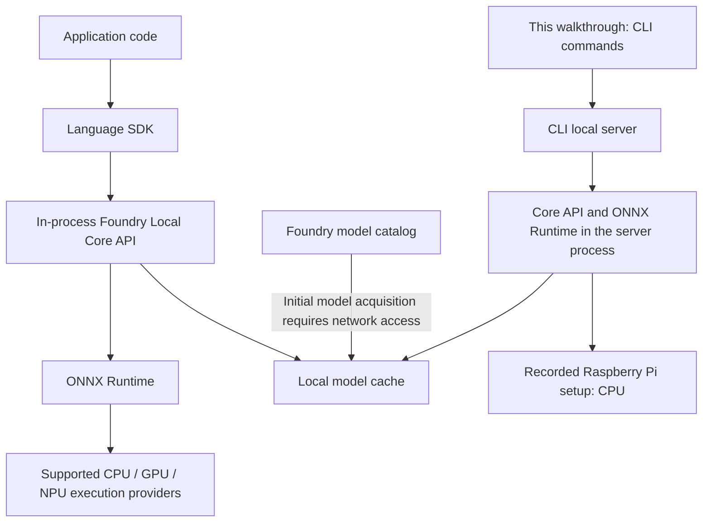

Running AI models on a Raspberry Pi involves more than checking whether a model fits in memory. Runtime installation, model downloads, hardware compatibility, and application integration also matter. Foundry Local brings these tasks together in a local AI runtime and toolchain, allowing developers to validate models from the command line before integrating them into applications.

This article documents a Raspberry Pi 5 setup, covering the Foundry Local architecture, Linux ARM64 installation, model management, and transcription of existing English and Chinese audio files with Whisper Tiny. Inference runs on the Raspberry Pi itself and does not require an Azure subscription.

> **Version scope:** The main installation and transcription walkthrough uses the recorded Foundry Local **0.10.3** setup. Version numbers, model catalogs, and ports may differ in a new installation. For command options, consult the `--help` output of the version you have installed. References to 0.11.0 and the corresponding permission-recovery examples are identified separately below.
{: .prompt-info }

## 1. What Is Foundry Local?

Microsoft's [Foundry Local overview](https://learn.microsoft.com/en-us/azure/foundry-local/what-is-foundry-local) describes a local AI solution for on-device applications, including a runtime, SDKs, an optimized model catalog, and hardware adaptation capabilities.

For edge devices such as Raspberry Pi, the following capabilities are particularly relevant:

- **Local data processing:** Prompts, audio, and model outputs are processed locally during inference rather than being sent to a cloud model service.
- **Offline execution after caching:** Initial acquisition of models and required runtime components needs network access. Once these are available locally, models can run from the cache.
- **Unified model management:** Models can be discovered, downloaded, loaded, and unloaded through the CLI or SDKs.
- **Hardware abstraction:** ONNX Runtime execution providers (EPs) provide access to supported hardware. Compatible accelerators can be used when available; CPU execution is also supported.
- **Multiple integration options:** Applications can use an SDK or connect through an optional OpenAI-compatible local REST interface.

Here, "local" does not mean "never accesses the network after installation" or "has no cost." Initial downloads and component updates still require connectivity, and memory, storage, power consumption, and inference time remain practical constraints. Local inference avoids cloud per-token inference charges and the associated dependency on a hosted inference service.

## 2. Architecture: Runtime, Model Catalog, and CLI

According to the official [architecture documentation](https://learn.microsoft.com/en-us/azure/foundry-local/concepts/foundry-local-architecture), the foundation of Foundry Local is a native **Core API** that can be embedded in an application process. Applications access it through C#, JavaScript, Python, or Rust SDKs, and the Core API uses ONNX Runtime to execute models.

Consequently, **Foundry Local is more than a command-line tool, and not every application needs a separate background service**. The CLI and local server primarily support development-time validation, model management, and HTTP integration. This article follows the CLI workflow.



The responsibilities of the main components are summarized below:

| Component | Primary responsibility |
| --- | --- |
| Foundry Local Core API | Model lifecycle management, hardware adaptation, and inference sessions |
| ONNX Runtime | Model execution, graph optimization, and access to compute devices through EPs |
| Foundry model catalog | Optimized, versioned models and hardware-specific variants |
| Local cache | Storage of downloaded models to avoid repeated downloads |
| CLI and optional REST interface | Command-line validation, diagnostics, and integration with other tools |

On Windows, WinML can manage execution provider registration. On Linux and macOS, the Core API interfaces directly with ONNX Runtime. **Installing Foundry Local on a Linux-based Raspberry Pi does not require Windows WinML.**

Similarly, installing the Linux ARM64 package does not automatically enable the Raspberry Pi GPU or an attached AI accelerator. Acceleration depends on compatible hardware, drivers, execution providers, and model variants. The recorded setup uses CPU execution.

## 3. Recorded Environment and Prerequisites

The original status screenshot records the following environment:

| Item | Recorded value |
| --- | --- |
| Hardware | Raspberry Pi 5 Model B Rev 1.1, 4 logical cores |
| Operating system | Debian GNU/Linux 13 (trixie) |
| Architecture | ARM64 |
| Memory | Approximately 7.9 GB total and 7.1 GB available when checked |
| Disk | Root filesystem of approximately 58.2 GB, with 36.5 GB available when checked |
| GPU detection | Not detected |
| CLI version | 0.10.3 |

These values describe a particular device, not official minimum requirements. To reproduce the workflow, use a **64-bit ARM Linux system** and reserve sufficient memory and disk space for model caching and execution. Start by checking the system:

```bash
uname -m
cat /etc/os-release
free -h
df -h /
```

On ARM64 Linux, `uname -m` typically reports `aarch64`. An output of `armv7l` indicates a 32-bit environment, which cannot directly use the ARM64 package in this guide.

The examples retain the recorded `/home/pi` directory. If your username is not `pi`, replace the relevant paths with your own home directory. The download examples require `curl`, and extraction requires `tar`.

## 4. Download and Install the Linux ARM64 Package

### 4.1 Select the Correct Package

Open the [CLI Preview 0.10.3 release page](https://github.com/microsoft/foundry-local/releases/tag/cli-preview-0.10.3) and select the following file under Assets:

```text
foundry-0.10.3-linux-arm64.tar.gz
```

Do not select a `linux-x64`, Windows ARM64, or macOS ARM64 package. Similar architecture labels do not make these packages interchangeable with the Linux ARM64 build needed for Raspberry Pi.

Download directly on the Raspberry Pi:

```bash
cd /home/pi/Downloads
curl -fL \
  -o foundry-0.10.3-linux-arm64.tar.gz \
  https://github.com/microsoft/foundry-local/releases/download/cli-preview-0.10.3/foundry-0.10.3-linux-arm64.tar.gz
```

Alternatively, download the archive on another computer and transfer it to the Raspberry Pi using a USB drive or a file-transfer tool. This only handles acquisition of the installation archive; the initial model download still requires network access.

The release page provides SHA-256 verification for the package. Check the ARM64 archive used in this guide:

```bash
sha256sum foundry-0.10.3-linux-arm64.tar.gz
```

The expected digest for this release asset is:

```text
c530e6354f29335fee4fd676b0f945e53a2dedcfc73c64fe336a39d27dbaec82
```

If the digest does not match, do not proceed with installation. Download the file again and compare it with the release page.

### 4.2 Extract and Keep the Complete Directory

From the directory containing the archive, run:

```bash
tar xzf foundry-0.10.3-linux-arm64.tar.gz -C /home/pi
cd /home/pi/foundry-0.10.3-linux-arm64
./lib/foundry --version
```

The Linux package is used by extracting the archive. The CLI is located in the installation directory's `lib` subdirectory. Keep the complete extracted directory: copying only the `foundry` executable can omit components it needs at runtime.

The following screenshots show extraction of `foundry-0.10.3-linux-arm64.tar.gz` into `/home/pi` and the resulting installation directory in the file manager.


### 4.3 Use a Consistent Working Directory

To avoid confusion between `./lib/foundry` and `./foundry`, **the remaining walkthrough commands run from the installation directory's `lib` subdirectory**:

```bash
cd /home/pi/foundry-0.10.3-linux-arm64/lib
./foundry --version
```

If you remain in the installation root, the equivalent command is `./lib/foundry --version`. The `0.10.3` output shown below identifies the recorded version; a different installed release should report its own version number.


For comparison, the 0.11.0 release notes list updates to SDK and runtime packages at version 2.1.0, ONNX Runtime 1.30.0, and ONNX Runtime GenAI 0.17.1. Diagnostic output should therefore not be expected to remain identical across releases.

## 5. Check Status, Help, and the Local Server

### 5.1 Inspect Overall Diagnostics

```bash
./foundry status
```

The `status` command summarizes system, server, model, and connectivity information. Use it to confirm the architecture, available resources, and whether the CLI can currently reach the local server.


The screenshot reports `Not running` and `Local service: Not reachable`, indicating that the local server was not running at the time of inspection. **These messages alone do not establish an installation failure.** Subsequent model commands can trigger server startup, or you can start it explicitly:

```bash
./foundry server start
./foundry server status
```

### 5.2 Inspect Command Help

```bash
./foundry --help
./foundry model --help
```


The following commands are used in this walkthrough, with further details available in the official [CLI reference](https://learn.microsoft.com/en-us/azure/foundry-local/reference/reference-cli):

| Command | Purpose |
| --- | --- |
| `./foundry status` | Display overall diagnostic information |
| `./foundry model list` | List available models |
| `./foundry model info <model>` | Inspect a specific model |
| `./foundry model download <model>` | Download a model into the local cache |
| `./foundry cache list` | List cached models |
| `./foundry server status` | Inspect the local server status and address |
| `./foundry server logs` | View server and SDK logs |
| `./foundry transcribe --help` | Inspect audio transcription options |

### 5.3 Confirm the Local Server Address

```bash
./foundry server status
```


The recorded server is `Ready` at `http://127.0.0.1:46733`. This is the address for that particular session, not a fixed port shared by all installations. When integrating an HTTP client, use the address reported by your own environment.

The address `127.0.0.1` is the Raspberry Pi's loopback address. Entering the same address on another computer refers to that computer itself, not to the Raspberry Pi.

## 6. Discover and Download Whisper Tiny

### 6.1 Inspect the Model Catalog

```bash
./foundry model list
```


In the recorded session, this command first started the Foundry Local server and then displayed the model catalog. Pay particular attention to:

- **Type:** The model category, such as chat, speech, embedding, or multimodal.
- **Size:** An estimate of download and storage requirements, not the total memory required during inference.
- **Device:** The compute device associated with the model; the recorded entries use CPU.
- **Cached:** Whether the model is already available in the local cache.

The model catalog varies by version and platform; the screenshot is not a permanently fixed, exhaustive list. On a memory-constrained Raspberry Pi, availability in the catalog does not by itself establish suitability. Consider model size, available memory, and the intended task.

### 6.2 Download Using a Model Alias

This walkthrough uses `whisper-tiny` for audio file transcription:

```bash
./foundry model info whisper-tiny
./foundry model download whisper-tiny
```

The name `whisper-tiny` is a short model alias. Foundry Local can select a corresponding variant based on available hardware. Use a full model ID when you need to select a specific variant.


In the recorded setup, the alias resolved to `openai-whisper-tiny-generic-cpu:4`, with a reported download size of approximately **131 MB**. This identifies the variant and size observed at that time, not a guarantee for subsequent releases.

After downloading, inspect the cache:

```bash
./foundry cache location
./foundry cache list
```

Keep three operations distinct: **downloading** stores the model on disk, **loading** prepares it for execution, and **transcription** actually processes audio. A successful download alone does not validate inference.

## 7. Transcribe Existing English and Chinese Audio Files

### 7.1 Confirm the Options

```bash
./foundry transcribe --help
```


The examples use three options:

| Option | Meaning |
| --- | --- |
| `-m` / `--model` | Specify a speech model alias or model ID |
| `-l` / `--language` | Provide a language hint, such as `en` or `zh` |
| `-f` / `--file` | Specify a local audio file and exit after processing |

This article uses file transcription with `-f`. Command-line options must use ordinary hyphen characters (`-`), not typographic dashes introduced by document formatting.

### 7.2 English MP3 File

The recorded English example uses `/home/pi/Documents/Recording.mp3`:

```bash
./foundry transcribe \
  -m whisper-tiny \
  -l en \
  -f /home/pi/Documents/Recording.mp3
```


The terminal produced English text, demonstrating model invocation, audio file reading, and local transcription in this environment. Replace the file path when using your own audio, and enclose paths containing spaces in quotes.

### 7.3 Chinese WAV File

The recorded Chinese example uses `/home/pi/Documents/output_16k_mono.wav`:

```bash
./foundry transcribe \
  -m whisper-tiny \
  -l zh \
  -f /home/pi/Documents/output_16k_mono.wav
```


The `-l zh` option supplies a Chinese language hint; it does not request translation of arbitrary languages into Chinese. The screenshot shows Chinese transcription output for Chinese audio in the recorded environment.

The filename `output_16k_mono.wav` suggests a 16 kHz mono example, but a filename alone does not verify audio properties. It also does not establish that this is the only accepted format. The recorded examples demonstrate successful processing of both MP3 and WAV files.

### 7.4 Interpret the Results Carefully

The screenshots demonstrate a **working file transcription workflow**, but they do not provide consistent audio durations, timing measurements, error rates, or repeated trials. They therefore cannot establish a particular real-time factor or a numerical Chinese recognition accuracy.

For application evaluation, use representative audio from your own workload. Record transcription time and memory consumption, and manually inspect terminology, punctuation, and omissions. Whisper Tiny is small enough for an initial lightweight evaluation, but a smaller model does not imply equal recognition quality across languages and use cases.

## 8. Diagnose Two Types of Permission Errors

The original records include two easily confused `Permission denied` cases: one affecting the CLI executable, and another affecting the server executable that the CLI starts.

The recovery commands below use the `foundry-0.10.3-linux-arm64` installation directory. Replace it with your actual installation path; for the 0.10.3 walkthrough above, use the corresponding 0.10.3 directory instead. These are alternative version-specific paths, not instructions to mix files from different releases.

### 8.1 The CLI Cannot Execute

For example, running `./lib/foundry --version` from the installation root may produce:

```text
bash: ./lib/foundry: Permission denied
```

Inspect the executable and add execute permission for its owner:

```bash
cd /home/pi/foundry-0.10.3-linux-arm64
ls -l lib/foundry
chmod u+x lib/foundry
./lib/foundry --version
```


### 8.2 The CLI Runs, but the Local Server Cannot Start

The second case occurs during commands such as `model list`, which require the local server. The screenshot reports that `lib/foundrylocald` within the installation directory cannot be started because of `Permission denied`.


The original recovery added execute permission to files in the `lib` directory in bulk. A more conservative approach is to **use the exact executable path reported in the error and change only the permissions needed for that file**. For the `foundrylocald` executable shown in the screenshot:

```bash
cd /home/pi/foundry-0.10.3-linux-arm64
ls -l lib/foundrylocald
chmod u+x lib/foundrylocald
./lib/foundry server start
./lib/foundry server status
./lib/foundry model list
```

If your version reports a different executable path, first confirm that the file belongs to the official installation package, then address that specific file. There is no need to use `chmod 777`, and routinely running model commands with `sudo` is not a recommended workaround.

If the executable already has execute permission, inspect whether its filesystem is mounted with `noexec`, whether the containing directories allow access, and whether the installation package is complete. Do not keep broadening permissions without identifying the cause.

### 8.3 Use Logs to Diagnose Other Issues

From the `lib` directory, run:

```bash
./foundry status
./foundry server status
./foundry server logs
```

For a server connectivity issue, the official CLI documentation suggests trying a restart:

```bash
./foundry server restart
./foundry server status
```

A restart cannot repair missing files or executable permissions. For download failures, distinguish between downloading the installation archive and downloading a model, then check the relevant network connection and available disk space. Do not interpret every failure as evidence that the model does not support Raspberry Pi.

## 9. Summary

The recorded setup demonstrates the complete Raspberry Pi 5 workflow: extracting the installation package, checking status, discovering and caching a model, and transcribing English and Chinese audio files with Whisper Tiny.

For developers, Foundry Local offers more than a way to get a model running. It brings model acquisition, hardware adaptation, caching, and inference interfaces together. Start with the CLI to determine whether a model suits your Raspberry Pi and data, then choose an SDK or the local REST interface for application integration.

Three boundaries remain important: **initial acquisition of models and components requires network access; ARM64 support does not imply support for every accelerator; and one successful transcription is not a performance or accuracy evaluation.** Within these limits, Foundry Local provides a practical route to on-device AI experimentation.

## References

- [What is Foundry Local?](https://learn.microsoft.com/en-us/azure/foundry-local/what-is-foundry-local)
- [Foundry Local architecture overview](https://learn.microsoft.com/en-us/azure/foundry-local/concepts/foundry-local-architecture)
- [Foundry Local CLI reference](https://learn.microsoft.com/en-us/azure/foundry-local/reference/reference-cli)
- [Foundry Local CLI Preview 0.11.0 release notes and packages](https://github.com/microsoft/foundry-local/releases/tag/cli-preview-0.11.0)