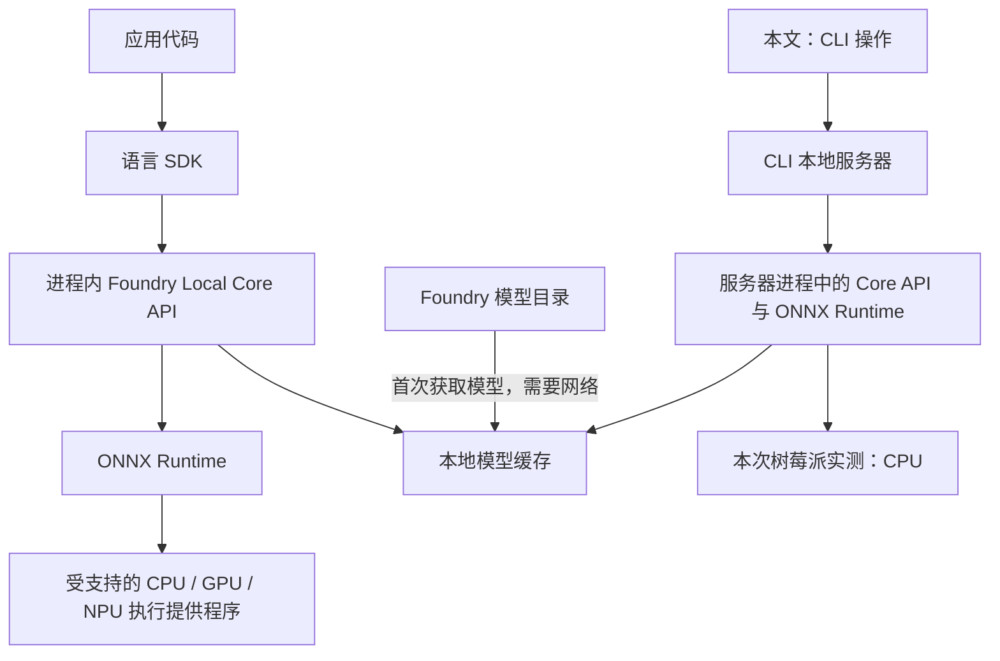

把 AI 模型放到树莓派上运行，除了关注模型能否装进内存，还需要处理运行时安装、模型下载、硬件适配和应用调用。Foundry Local 将这些工作放到同一套本地 AI 运行时与工具链中，让我们可以先通过命令行验证模型，再考虑将能力集成到应用。

本文以 Raspberry Pi 5 上的实际操作记录为基础，介绍 Foundry Local 的架构、Linux ARM64 安装方式、模型管理，以及使用 Whisper Tiny 对已有的中英文音频文件进行转录。整个推理过程在树莓派本机执行，不需要 Azure 订阅。

> **版本说明**：本文截图来自 Foundry Local **0.10.3** 的实测记录；截图中的版本号、模型目录和端口不一定与新安装环境相同，具体选项以已安装最新版本的 `--help` 输出为准。
{: .prompt-info }

## 1. Foundry Local 是什么

根据微软的 [Foundry Local 概述](https://learn.microsoft.com/en-us/azure/foundry-local/what-is-foundry-local)，它是一套面向设备端应用的本地 AI 方案，包含运行时、SDK、经过优化的模型目录，以及硬件适配能力。

对树莓派这类边缘设备而言，可以重点关注以下能力：

- **本地处理数据**：提示词、音频及模型输出在本机完成推理，不需要上传到云端模型服务。
- **缓存后离线运行**：模型与所需运行组件首次获取时需要联网；准备完成后，可从本地缓存运行模型。
- **统一管理模型**：发现、下载、加载、卸载模型都可以通过 CLI 或 SDK 完成。
- **硬件抽象**：底层通过 ONNX Runtime 的执行提供程序（Execution Provider，EP）适配硬件；有受支持的加速设备时可以使用加速，没有时可以使用 CPU。
- **多种集成方式**：应用可以使用 SDK，也可以通过可选的 OpenAI 兼容本地 REST 接口接入。

这里的“本地”不等于“安装后从不访问网络”，也不等于“没有成本”。首次下载、组件更新等操作仍需要联网；设备的内存、存储、电力和推理时间也需要纳入考虑。它省去的是云端按 token 计费的推理调用，以及相应的后端服务依赖。

## 2. 理解架构：运行时、模型目录与 CLI

按照官方的 [架构说明](https://learn.microsoft.com/en-us/azure/foundry-local/concepts/foundry-local-architecture)，Foundry Local 的核心是可嵌入应用进程的原生 **Core API**。应用通过 C#、JavaScript、Python 或 Rust SDK 调用它，Core API 再调用 ONNX Runtime 完成模型推理。

因此，**Foundry Local 不只是一个命令行工具，也不要求每个应用都依赖独立的后台服务**。CLI 和本地服务器主要用于开发验证、模型管理及 HTTP 集成。本文使用的是 CLI 工作流。



各组件的分工可以概括为：

| 组件 | 主要职责 |
| --- | --- |
| Foundry Local Core API | 管理模型生命周期、硬件适配与推理会话 |
| ONNX Runtime | 执行模型，进行图优化，并通过 EP 使用计算设备 |
| Foundry 模型目录 | 提供经过优化、具有版本信息的模型及硬件变体 |
| 本地缓存 | 保存已经下载的模型，避免重复获取 |
| CLI 与可选 REST 接口 | 便于终端验证、诊断，以及与其他工具集成 |

Windows 平台可以通过 WinML 管理执行提供程序注册；Linux 和 macOS 则由 Core API 直接与 ONNX Runtime 对接。**在 Linux 树莓派上安装 Foundry Local，并不需要安装 Windows 的 WinML。**

同样，安装 Linux ARM64 包不意味着树莓派的 GPU 或外接 AI 加速器就一定能被使用。是否可以加速，还取决于设备、驱动、EP 和模型变体是否匹配。本文截图显示的计算设备是 CPU。

## 3. 实测环境与安装前准备

原始状态截图记录了以下环境：

| 项目 | 实测值 |
| --- | --- |
| 硬件 | Raspberry Pi 5 Model B Rev 1.1，4 个逻辑核心 |
| 操作系统 | Debian GNU/Linux 13（trixie） |
| 架构 | ARM64 |
| 内存 | 总量约 7.9 GB，检查时可用约 7.1 GB |
| 磁盘 | 检查时根文件系统总量约 58.2 GB，可用约 36.5 GB |
| GPU 检测 | Not detected |
| CLI 版本 | 0.10.3 |

这是一份具体设备的运行记录，不是官方最低配置要求。准备复现时，应使用 **64 位 ARM Linux 系统**，并预留模型缓存与运行所需的内存、磁盘空间。可以先检查系统：

```bash
uname -m
cat /etc/os-release
free -h
df -h /
```

在 ARM64 系统中，`uname -m` 通常显示 `aarch64`。如果显示的是 `armv7l`，说明当前运行的是 32 位系统，不能直接使用本文的 ARM64 包。

下面沿用实测中的 `/home/pi` 目录。如果设备用户名不是 `pi`，请将相关路径替换为自己的用户目录。下载示例需要系统中已有 `curl`，解压需要 `tar`。

## 4. 下载并安装 Linux ARM64 版

### 4.1 选择正确的安装包

打开 [CLI Preview 0.10.3 发布页](https://github.com/microsoft/foundry-local/releases/tag/cli-preview-0.10.3)，在 Assets 中选择：

```text
foundry-0.10.3-linux-arm64.tar.gz
```

不要误选 `linux-x64`、Windows ARM64 或 macOS ARM64 包：它们即使名称中包含相似的架构标记，也不是树莓派 Linux 所需的文件。

可以在树莓派上直接下载：

```bash
cd /home/pi/Downloads
curl -fL \
  -o foundry-0.10.3-linux-arm64.tar.gz \
  https://github.com/microsoft/foundry-local/releases/download/cli-preview-0.10.3/foundry-0.10.3-linux-arm64.tar.gz
```

也可以在另一台电脑上下载后，通过 U 盘或文件传输工具复制到树莓派。注意，这只解决安装包获取问题；后续首次下载模型仍需要网络。

发布页为安装包提供 SHA-256 校验。核对本文指定的 ARM64 包：

```bash
sha256sum foundry-0.10.3-linux-arm64.tar.gz
```

该发布资产的预期摘要为：

```text
c530e6354f29335fee4fd676b0f945e53a2dedcfc73c64fe336a39d27dbaec82
```

如果不一致，不要继续安装，应重新获取文件并核对发布页。


### 4.2 解压并保留完整目录

在安装包所在目录执行：

```bash
tar xzf foundry-0.10.3-linux-arm64.tar.gz -C /home/pi
cd /home/pi/foundry-0.10.3-linux-arm64
./lib/foundry --version
```

Linux 包采用解压使用的方式，CLI 位于安装目录的 `lib` 子目录中。应保留整个解压目录，不要只将 `foundry` 文件复制出去，否则可能丢失它需要的运行组件。

下面两张图展示的是实测中的过程：将 `foundry-0.10.3-linux-arm64.tar.gz` 解压到 `/home/pi`，随后在文件管理器中找到安装目录。


### 4.3 统一后续命令的执行位置

为避免在 `./lib/foundry` 和 `./foundry` 之间切换造成混淆，**后续示例都从安装目录的 `lib` 子目录执行**：

```bash
cd /home/pi/foundry-0.10.3-linux-arm64/lib
./foundry --version
```

如果仍停留在安装根目录，等价写法是 `./lib/foundry --version`。截图中的 `0.10.3` 仅表示实测版本；新安装的版本应输出相应的新版本号。


目前，0.11.0 发布说明还列出了 SDK 与运行时包更新到 2.1.0、ONNX Runtime 更新到 1.30.0、ONNX Runtime GenAI 更新到 0.17.1 等变化。因此，不应期待新旧版本的全部诊断信息完全一致。

## 5. 检查状态、帮助与本地服务器

### 5.1 查看整体诊断信息

```bash
./foundry status
```

`status` 会汇总系统、服务器、模型与连接等诊断信息。它适合用来确认架构、可用资源，以及 CLI 当前是否能连接本地服务器。


截图中的 `Not running` 和 `Local service: Not reachable` 表示检查时本地服务器尚未运行，**并不能单独说明安装失败**。后续模型命令可以触发服务器启动，也可以显式执行：

```bash
./foundry server start
./foundry server status
```

### 5.2 查看命令帮助

```bash
./foundry --help
./foundry model --help
```


结合官方 [CLI 参考](https://learn.microsoft.com/en-us/azure/foundry-local/reference/reference-cli)，本文主要使用以下命令：

| 命令 | 用途 |
| --- | --- |
| `./foundry status` | 查看综合诊断信息 |
| `./foundry model list` | 查看可用模型 |
| `./foundry model info <model>` | 查看指定模型信息 |
| `./foundry model download <model>` | 将模型下载到本地缓存 |
| `./foundry cache list` | 查看已经缓存的模型 |
| `./foundry server status` | 查看本地服务器状态与地址 |
| `./foundry server logs` | 查看服务器及 SDK 日志 |
| `./foundry transcribe --help` | 查看音频转录参数 |


### 5.3 确认本地服务器地址

```bash
./foundry server status
```


实测截图显示服务器处于 `Ready` 状态，地址为 `http://127.0.0.1:46733`。这是当次运行的地址，不是所有安装都使用的固定端口；需要集成 HTTP 客户端时，应读取自己环境中的状态输出。

`127.0.0.1` 是树莓派本机的回环地址。在另一台电脑上访问同样的地址，访问的是那台电脑自己，而不是树莓派。

## 6. 发现并下载 Whisper Tiny 模型

### 6.1 查看模型目录

```bash
./foundry model list
```


实测中，该命令先启动了 Foundry Local 服务器，然后显示模型列表。可以重点查看：

- **Type**：模型类型，例如聊天、语音、嵌入或多模态。
- **Size**：用于估算下载与存储规模，不等于推理时占用的全部内存。
- **Device**：当前模型对应的计算设备；截图中列出的设备为 CPU。
- **Cached**：模型是否已在本地缓存。

模型目录会随版本和平台变化，截图不是固定的完整清单。对于内存有限的树莓派，不能只看到“模型在目录里”就认为它适合当前设备；还应结合模型大小、可用内存和实际任务选择。

### 6.2 使用模型别名下载

本文选择 `whisper-tiny` 进行音频文件转录：

```bash
./foundry model info whisper-tiny
./foundry model download whisper-tiny
```

`whisper-tiny` 是较短的模型别名。Foundry Local 可以根据可用硬件选择相应变体；需要固定某个变体时，则使用完整模型 ID。


实测中，别名解析为 `openai-whisper-tiny-generic-cpu:4`，显示下载大小约 **131 MB**。这是当时的模型版本和大小，不应作为后续版本始终不变的保证。

下载成功后，可以确认缓存：

```bash
./foundry cache location
./foundry cache list
```

这里需要区分三个动作：**下载**是将模型保存到磁盘，**加载**是将模型准备到运行环境中，**转录**才是实际处理音频。下载完成提示不代表已经完成推理验证。

## 7. 转录已有的中英文音频文件

### 7.1 先确认参数

```bash
./foundry transcribe --help
```


本例使用三个参数：

| 参数 | 含义 |
| --- | --- |
| `-m` / `--model` | 指定语音模型别名或模型 ID |
| `-l` / `--language` | 提供语言提示，例如 `en` 或 `zh` |
| `-f` / `--file` | 指定本地音频文件，处理后退出 |

本文使用带 `-f` 的文件转录方式。命令中的连字符应为普通的 `-`，不要替换为文档排版中的长横线。

### 7.2 英文 MP3 文件

实测使用 `/home/pi/Documents/Recording.mp3`：

```bash
./foundry transcribe \
  -m whisper-tiny \
  -l en \
  -f /home/pi/Documents/Recording.mp3
```


终端输出了英文文本，说明该环境中已经完成模型调用、音频文件读取与本地转录。若使用自己的文件，请替换为实际路径；路径包含空格时，需要用引号包裹。

### 7.3 中文 WAV 文件

中文实测使用 `/home/pi/Documents/output_16k_mono.wav`：

```bash
./foundry transcribe \
  -m whisper-tiny \
  -l zh \
  -f /home/pi/Documents/output_16k_mono.wav
```


`-l zh` 是中文语言提示，不是“将任意语言翻译成中文”的选项。截图表明，该实测环境能够对中文音频产生中文转录结果。

文件名 `output_16k_mono.wav` 表明示例按 16 kHz 单声道命名，但不能仅凭文件名确认音频属性，也不能据此断言 CLI 只接受这一种格式。本文实际展示了 MP3 和 WAV 两种文件的成功处理。

### 7.4 如何理解结果

这些截图验证了**文件转录流程可用**，但没有提供统一的音频时长、耗时统计、错误率或重复测试数据。因此，不能从截图推出“达到某个实时倍率”或“中文识别准确率达到某个百分比”。

在应用中选型时，建议使用自己的代表性音频，记录转录耗时、内存占用，并人工检查术语、标点和漏字。Whisper Tiny 的体积适合先做轻量验证，但更小的模型并不意味着所有语言和场景都能获得同样的识别质量。

## 8. 两类权限问题及排查方法

原始实测遇到了两个容易混淆的 `Permission denied` 问题：一个发生在 CLI 文件上，另一个发生在它启动的服务器程序上。

### 8.1 CLI 无法执行

例如，在安装根目录运行 `./lib/foundry --version` 时出现：

```text
bash: ./lib/foundry: Permission denied
```

可以检查并为当前用户补充执行权限：

```bash
cd /home/pi/foundry-0.11.0-linux-arm64
ls -l lib/foundry
chmod u+x lib/foundry
./lib/foundry --version
```


### 8.2 CLI 能运行，但本地服务器无法启动

第二类错误出现在 `model list` 等需要本地服务器的操作中。截图提示无法启动安装目录下的 `lib/foundrylocald`，原因同样是 `Permission denied`。


原记录通过给 `lib` 目录内的文件批量添加执行权限恢复了运行。更稳妥的做法是**根据错误中出现的具体程序路径，仅修复需要执行的文件**。针对截图中的 `foundrylocald`：

```bash
cd /home/pi/foundry-0.11.0-linux-arm64
ls -l lib/foundrylocald
chmod u+x lib/foundrylocald
./lib/foundry server start
./lib/foundry server status
./lib/foundry model list
```

如果当前版本报错中的程序路径不同，应先确认该文件属于官方安装包，再针对实际文件处理。没有必要使用 `chmod 777`，也不建议通过 `sudo` 长期运行模型命令来绕过权限问题。

若文件已有执行权限但仍然报错，应继续检查安装目录所在文件系统是否以 `noexec` 挂载、目录访问权限，以及包是否完整，不能不断扩大授权范围。

### 8.3 结合日志定位其他问题

在 `lib` 目录中可以执行：

```bash
./foundry status
./foundry server status
./foundry server logs
```

若只是服务器连接异常，可按官方 CLI 文档建议尝试：

```bash
./foundry server restart
./foundry server status
```

但重启不能修复缺失文件或执行权限问题。下载失败时还应区分安装包下载与模型下载，检查对应网络连接和磁盘空间；不要把所有失败都归因于模型不支持树莓派。

## 9. 小结

这次实测打通了 Raspberry Pi 5 上从解压安装、检查状态、发现和缓存模型，到使用 Whisper Tiny 转录中英文音频文件的完整流程。

对开发者而言，Foundry Local 的价值不仅在于“让模型跑起来”，还在于将模型获取、硬件适配、缓存与推理接口统一起来。可以先用 CLI 验证模型是否适合自己的树莓派和数据，再选择 SDK 或本地 REST 接口进行应用集成。

最后保留三个边界：**首次获取模型与组件需要网络；ARM64 支持不等于任意加速器都受支持；一次成功转录不等于完成性能与准确率评测。** 在这些边界内，它提供了一条比较直接的设备端 AI 实践路径。

## 参考资料

- [What is Foundry Local?](https://learn.microsoft.com/en-us/azure/foundry-local/what-is-foundry-local)
- [Foundry Local architecture overview](https://learn.microsoft.com/en-us/azure/foundry-local/concepts/foundry-local-architecture)
- [Foundry Local CLI reference](https://learn.microsoft.com/en-us/azure/foundry-local/reference/reference-cli)
- [Foundry Local CLI Preview 0.11.0 发布说明与安装包](https://github.com/microsoft/foundry-local/releases/tag/cli-preview-0.11.0)

